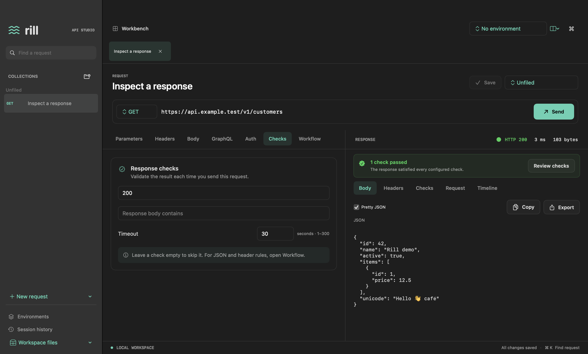
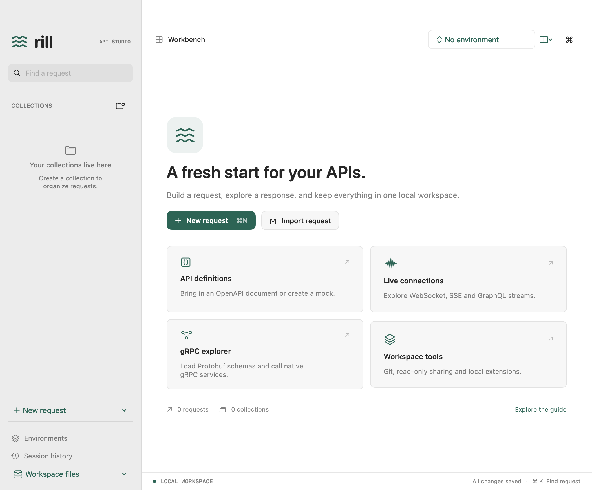

# Rill

[](https://github.com/alby-raju/Rill/actions/workflows/swift.yml) [](https://github.com/alby-raju/Rill/actions/workflows/security.yml) [](LICENSE)

**A native macOS API workbench, built with Swift and SwiftUI.**

Compose requests, inspect responses, run API workflows, and explore live protocols in a local workspace. Rill works without an account or hosted workspace. Its name comes from a small stream.

[Wiki](https://github.com/alby-raju/Rill/wiki) · [Get started](#get-started) · [Features and limits](docs/FEATURES.md) · [CLI](docs/CLI.md) · [Contribute](CONTRIBUTING.md) · [Roadmap](ROADMAP.md) · [Community and support](SUPPORT.md)



## MVP status

Rill is an **MVP development build** for **macOS 15+**, on Apple Silicon and Intel. The app and CLI share the same execution engine. This is a usable first release with documented protocol/import subsets; it is not a claim of complete standards conformance or parity with another product.

Development installers are ad-hoc signed. Paid Developer ID signing and notarization are deferred. See [installation and release notes](docs/RELEASE.md) for the exact distribution status and remaining acceptance gates.

## Where Rill is heading

Our next focus is **CLI-first API testing**: direct collection/environment file runs, explicit script compatibility, useful failure reports, a visible mock workbench, and measured large-workspace performance. Linux and Windows are planned as CLI portability work first; desktop apps require a separate architecture decision.

**These enhancements are planned, not available in the current release.** Read the [prioritized roadmap](ROADMAP.md) and [suggest priorities in Discussions](https://github.com/alby-raju/Rill/discussions). The [Wiki](https://github.com/alby-raju/Rill/wiki) is the onboarding hub; versioned documentation in this repository defines current behavior.

## What you can do

- Organize collections, tabs, drafts and inherited environments; recover edits and create backups.
- Send HTTP requests with JSON/XML/text, forms, multipart and binary uploads; configure auth, named Keychain secrets and TLS profiles.
- Inspect bodies, headers, checks and timelines. Validation results stay visible separately from HTTP status.
- Chain requests with assertions, extraction, finite opt-in hooks, retries, environment matrices and bounded load tests.
- Import/export supported Postman, Insomnia, Bruno, HAR and HTTPie representations; generate client snippets.
- Work with OpenAPI/Swagger, supported JSON Schema contracts, local mocks and explicit inspection tools.
- Explore GraphQL, subscriptions, WebSocket, SSE, gRPC, MQTT, AMQP and Kafka within the [published limits](docs/FEATURES.md).
- Run workflows from the CLI with readable summaries, detailed attempts/checks and JSON/Markdown/JUnit/Allure exports.



Screenshots use synthetic sample data rendered by the actual app. No personal workspace or credentials are shown.

## Get started

To build from source, install full **Xcode 26.2+** with **Swift 6.2.3+**:

```sh
git clone https://github.com/alby-raju/Rill.git
cd Rill
export DEVELOPER_DIR=/Applications/Xcode.app/Contents/Developer
swift run Rill
```

Open `Package.swift` in Xcode if you prefer the IDE. To create a local app bundle:

```sh
zsh scripts/package.sh
```

The output is `dist/Rill.app`; its bundled CLI is `dist/Rill.app/Contents/Helpers/rill`. Packaging includes the selected native runtimes, official protobuf compiler, licenses and offline help. It does not require Java or install a hosted service.

## Try it with local test data

```sh
python3 verification/server.py
```

In Rill choose **File → Import Rill Workspace…**, select `verification/materials/rill-workspace.json`, apply the preview and select **Verification local**. Start with **Kit — Smoke**. The **Expected failures** collection is deliberately supposed to fail its checks.

The [verification guide](verification/README.md) includes endpoints, upload files, format samples, optional gRPC/TLS setup and a blank acceptance checklist. Build a portable kit with `python3 scripts/build-verification-kit.py`.

## For developers

Start with [CONTRIBUTING.md](CONTRIBUTING.md). The [architecture guide](docs/ARCHITECTURE.md) explains the source layout, and [testing guide](docs/TESTING.md) covers the fixture-backed suite, formatting and visual diagnostics.

```sh
bash scripts/test.sh
python3 scripts/check-docs.py
```

CI builds and tests Apple Silicon with Xcode 26.2/26.3 and Intel with Xcode 26.3, verifies the app bundle and manual test kit, and executes generated client programs.

## License and support

Rill's original code is available under the [MIT License](LICENSE). Dependencies retain their own licenses; see [THIRD_PARTY_NOTICES.txt](THIRD_PARTY_NOTICES.txt) and the [dependency guide](docs/DEPENDENCIES.md).

[Report a bug or request a feature](SUPPORT.md). Report sensitive vulnerabilities through the process in [SECURITY.md](SECURITY.md).
